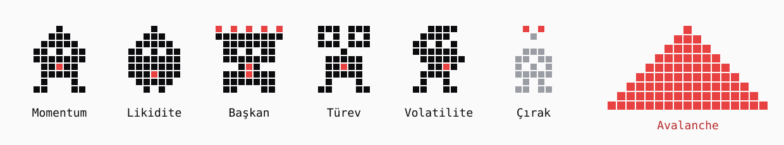

# Darwin Council

### A live AI council that can say **WAIT** before an AVAX buy — and show exactly why.

**[▶ Live dashboard](https://darwin-council.vercel.app)** *(interface only; the live backend runs locally because it holds a real OKX TR subaccount)* · **[▶ Pitch deck](https://darwin-council.vercel.app/pitch)** · **[🇹🇷 Jüri için (Turkish, for judges)](FOR_JUDGES.md)** · **[Lineage contract](https://testnet.snowtrace.io/address/0xd75db90c8337a12de7293882b0251b0af78619dd)** · **[Commit contract](https://testnet.snowtrace.io/address/0x3cd8babe00dd10c08ebfc6435c1a41e6bde5a95a)**



> Built for the **OKX TR × Team1 Agentic Hackathon**, Ankara, 17 October 2026. Judges: the Turkish summary in [FOR_JUDGES.md](FOR_JUDGES.md) maps the project to every judging criterion and links the live on-chain evidence.

| Built with | Used for |
| --- | --- |
| **OKX Agent Trade Kit** | Live OKX TR market data, historical candles for scoring, subaccount balance, and spot orders |
| **Avalanche Fuji (C-Chain testnet)** | `DarwinCommit` (commit/reveal of every forecast and buy decision) and `DarwinLineage` (analyst birth, trial result, retirement) |
| **OpenAI** | Four specialist analyst roles and a chair that explains but cannot change the decision |

*The hosted dashboard is a static copy of the interface, so it shows no live data. The live backend is intentionally not exposed to the internet: it is connected to a real OKX TR subaccount with trading permission and holds private API keys. It runs locally (`127.0.0.1:8787`) and is shown in the live demo; every decision it makes is publicly verifiable on Snowtrace.*

**Darwin Council** helps a person decide whether *now* is a reasonable moment to buy AVAX on OKX TR. Four AI analysts inspect fresh market data from different angles, challenge one another's views, and vote **BUY**, **WAIT**, or **BLOCK**. The final decision comes from explicit, inspectable rules. A small order is never treated as an automatic buy.

Meanwhile, the same analysts take an ongoing test: they forecast the next 30 minute AVAX/USDT outcome, lock their answer on Avalanche Fuji before it is known, and are scored against the real result. A new analyst can earn a seat only by beating an incumbent on future live rounds.

> **The useful output is a decision with reasons, including a reason to do nothing.** The forecast loop measures the analysts; it does not trade by itself.

## The problem

“AI says buy” is easy to produce. It rarely tells you which data it used, whether a quoted number was real, what changed while the agent was thinking, or why a trade was allowed. A one word signal also hides the most valuable answer in a risky market: **wait**.

Darwin Council turns that vague signal into a review a user can inspect: independent opinions, checked numerical claims, a second vote after discussion, a fresh market snapshot, and a visible rule for the final decision. The council's past forecasts are scored and shown on the board rather than described as successful without evidence.

## See it work

The interface is in Turkish. **İşlem** is the live buy review; **Pano** is the results and system board.

1. Open the local dashboard and watch the live OKX TR price, current round, and four analyst summaries. The scheduled forecast rounds run without a user request.
2. In **İşlem**, ask the council to assess a **5 USDT AVAX buy**. Leave real execution off to review the decision without sending an order.
3. Follow the live sequence: market snapshot → blind opinions → checked claims → peer review → fresh market check → **AL / BEKLE / ENGELLE** (`BUY / WAIT / BLOCK`). The screen shows the vote count and the rule that decided the result.
4. Open **Zincir ve emir adımları** to inspect the Fuji commit and reveal links and the order status. Open **Pano** to inspect past forecast outcomes, analyst scores, and Darwin's challenger decision.

If the council says **WAIT** or **BLOCK**, no order is sent. If it says **BUY**, a real OKX TR spot order still requires the user's explicit execution choice, enabled server configuration, a connected subaccount, and one more set of safeguards. The automatic forecast rounds **never** place orders.

## Two connected loops

| Loop | Trigger | What the council does | What the user gets |
| --- | --- | --- | --- |
| **Live buy review** | User asks about a 5 USDT AVAX purchase | Four roles vote, review peers, and face market and policy checks | `BUY`, `WAIT`, or `BLOCK`, with votes, reasons, rule checks, and Fuji evidence; an optional real spot buy only after explicit opt in |
| **Darwin trial** | Local scheduler starts a round | Analysts predict the price direction of the completed AVAX/USDT candle 30 minutes ahead; the outcome is scored later | A time locked forecast, real outcome, Brier score, and evidence for keeping or replacing an analyst |

The roles are **Momentum**, **Liquidity**, **Relative Market / Derivatives**, and **Volatility**. They are separate specialist model calls inside one Node.js service and use one OpenAI API key; they are not separate wallets or independently running processes. Analysts first respond without seeing peers, then get a chance to revise after seeing verified initial views. A numerical claim that fails the market snapshot check cannot contribute a vote. The verifier checks structured numerical fields, not every sentence of free text.

### How a buy decision is reached

```text
User: “Should I buy 5 USDT of AVAX now?”
                    │
                    ▼
        Live OKX TR market snapshot
                    │
                    ▼
      Four blind analyst assessments
                    │
                    ▼
       Check quoted market numbers
                    │
                    ▼
        Peer review and final votes
                    │
                    ▼
         Read the market again
                    │
                    ▼
   Fixed policy: freshness, spread, depth,
   recent movement, price drift, verified votes
                    │
                    ▼
           BUY / WAIT / BLOCK
                    │
                    ▼
       Commit and reveal on Fuji
                    │
                    └── BUY + user opt in + safeguards
                              → optional OKX TR spot buy
```

For example, **two BUY votes and two WAIT votes produce WAIT**, even if the order is only 5 USDT. A BUY needs at least **three verified BUY votes and zero BLOCK votes**, plus passing market checks. Stale data or insufficient order book depth can block the request. These are rules in code, not a model's promise of profit.

## What can be verified

| Claim | Evidence in this build |
| --- | --- |
| The data is live | OKX TR Agent Trade Kit ticker, candles, and order book have source timestamps and freshness states. Missing data is shown as unavailable. |
| The forecast was made before the answer | A hash of the forecast payload is committed to an Avalanche Fuji contract before the target candle closes, then revealed after the real outcome arrives. |
| Analyst quality is measured | Resolved rounds use a Brier score; the board also shows the constant 50% forecast as a reference. A few short horizon outcomes do not establish trading skill. |
| Darwin actually makes a decision | A challenger is tested on six **future paired live rounds**. Promotion or rejection and analyst lineage are recorded on Fuji. A trial analyst does not vote in the active council. |
| An order was or was not sent | The trade review records its decision and execution state separately. `ACCEPTED` is not presented as `FILLED`; an uncertain order response is not blindly retried. |

Use `npm run audit:round -- <round-id>` to compare a resolved forecast with the stored payload, OKX TR target candle, score, and Fuji events. Use `npm run audit:lineage` to check the analyst ancestry and decision events directly against Fuji. The dashboard links to the relevant explorer transactions.

**Avalanche Fuji stores commitments and analyst lineage.** Market data and optional spot orders live on OKX TR. A chain hash proves the committed bytes were fixed at that point in time; it does not certify the source data or make a prediction correct.

## Where it runs

```text
OKX TR market ── Agent Trade Kit ──┐
                                  ▼
                     Node.js council coordinator
                     ├─ four OpenAI analyst roles
                     ├─ numerical claim verifier
                     ├─ fixed trade policy
                     └─ scheduler + SQLite state
                           │             │
                           ▼             └── same-origin live dashboard
                Avalanche Fuji contracts
                (commit/reveal + lineage)

Optional, user-initiated BUY ── safeguards ── OKX TR spot API
```

The server and dashboard run locally at `127.0.0.1:8787`. The market snapshot refreshes in the background. Forecast rounds initially start every 10 minutes to gather enough real evidence for Darwin's first decision; after that they start every 30 minutes. **Every forecast still looks 30 minutes ahead.** Missed starts are not recreated as if they had happened live.

## Run locally

Developed with **Node.js 25.6.1**. Use a Node.js version with the built in `node:sqlite` module.

```bash
git clone https://github.com/yigitturaan/darwin-council.git
cd darwin-council
npm ci
cp .env.example .env
npm run wallet:create
npm run contract:compile
```

Add your `OPENAI_API_KEY` to `.env`. Fund the newly created wallet's **public address** with Fuji C-Chain test AVAX, then deploy the contracts and start the service:

```bash
npm run contract:deploy
npm run lineage:deploy
npm run backend
```

Open **http://127.0.0.1:8787/**. Deployment scripts save the Fuji contract addresses to your local `.env`; restart the backend after changing environment values. Public OKX TR market reads do not need an OKX account API key. Running the full loop uses real OpenAI calls and Fuji testnet transactions, so it needs API credit, test AVAX, and an internet connection.

### Optional: connect an OKX TR subaccount

For a live balance display or real spot execution, create a **dedicated standard subaccount** API key with Read and Trade permissions, and put its three values in a local `.env.okx` file:

```dotenv
OKX_API_KEY=
OKX_SECRET_KEY=
OKX_PASSPHRASE=
```

Run `npm run account:check` to check the connection **without placing an order**. Real orders are off by default (`ENABLE_LIVE_ORDERS=false`). Even when enabled, one request must explicitly select execution and receive `BUY`. The server rechecks the market and balance, caps a request at **5 USDT**, and blocks a second real order for 24 hours. No withdrawal permission is required. Keep `.env` and `.env.okx` local; both are excluded from Git.

## Commands and code

| Command | Use |
| --- | --- |
| `npm run smoke:market` | Read a real OKX TR market snapshot |
| `npm run smoke:model` | Check a real OpenAI response |
| `npm run smoke:fuji` | Check the Fuji wallet, RPC, and contracts |
| `npm run check:live` | Check the running API and connected services |
| `npm run audit:round -- <round-id>` | Verify a resolved round and its chain record |
| `npm run audit:lineage` | Verify analyst lineage on Fuji |

- [`backend/`](backend/) contains the council, ATK reader, policy, persistence, and Solidity contracts.
- [`frontend/`](frontend/) contains the live Turkish dashboard served by the backend.
- [`backend/API.md`](backend/API.md) describes the HTTP interface.
- [`backend/README.md`](backend/README.md) documents recovery, scoring, and operational details.

## Inspiration and what we built from it

We studied [aoxbt](https://github.com/Nava-Labs/aoxbt)'s specialist agent roles, [DAIO](https://github.com/openDAIO/agents)'s inspectable consensus workflow, [LPLens](https://github.com/JeanBaptisteDurand/Open_Agent_2026)'s evidence first presentation, and [DeFlow](https://github.com/AceVikings/ethonline-defi-layer)'s clear path from analysis to guarded action. Darwin Council applies those ideas to a narrow, working **OKX TR market → analyst council → verifiable decision** flow, with a separate live trial for analyst selection. Those projects have different products, chains, and execution models; this implementation is original to this repository.

## Scope

This hackathon build covers **AVAX/USDT on OKX TR**. It can review an on demand spot **buy**, and the code can submit that buy only under the opt in conditions above. The real order path has not been verified end to end with a filled order. It does not autonomously trade on every forecast, sell positions, or manage an OKX bot. Thirty minute direction forecasts are a noisy test question; the system reports outcomes and scores without claiming a profitable strategy. The local server is designed for a live demonstration on this machine, not public internet deployment.
